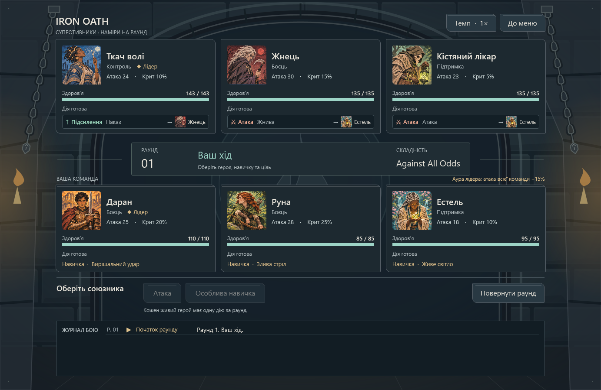
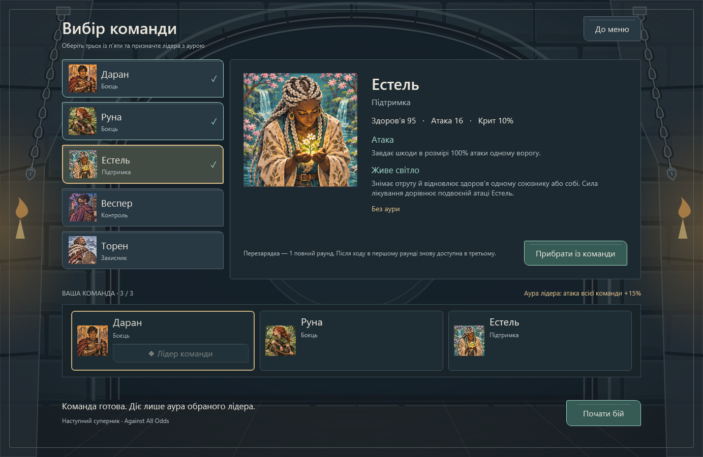
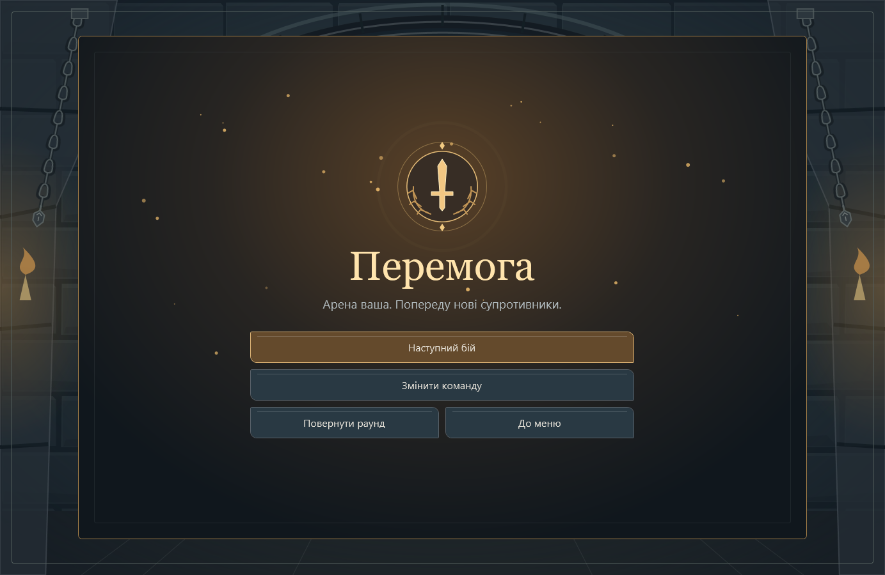

# Iron Oath

> **Three shall stand. One flame endures.**

**Покрокова тактика 3 × 3 на кам’яній арені.** Зберіть трійку героїв, оберіть лідера й подивіться, куди вороги готують удар. Один щит, вчасне оглушення або вдала послідовність навичок можуть вирішити раунд.

**Windows · C# · .NET 8 · WPF · Український інтерфейс**



## Що чекає на арені

- **П’ять героїв, одна команда.** Оберіть трьох і призначте лідера. Його аура посилить атаку або здоров’я всієї команди.
- **Наміри ворогів відкриті.** Значок, назва навички й портрет цілі підказують, кого захистити та чий хід варто зірвати.
- **Три рівні випробування.** Від First Blood до Against All Odds. Після перемоги виходить нова трійка ворогів. Після поразки можна змінити команду й переграти ту саму зустріч.

<details>
<summary>Ще два кадри з гри</summary>





</details>

## Запуск

У Windows із .NET 8 SDK виконайте з кореня репозиторію.

```powershell
cd "Iron Oath"
.\run.cmd
```

У папці `Iron Oath` також можна відкрити [ArenaTactics.sln](ArenaTactics.sln) у Visual Studio або виконати `dotnet run --project src/Arena.Wpf -c Release`. F11 перемикає повноекранний режим, Esc повертає у вікно.

## Документація

- [Задум гри та правила](docs/CONCEPT.md)
- [Архітектура, патерни й перевірки](docs/ARCHITECTURE.md)
- [Герої, здібності та аури](HEROES.md)
