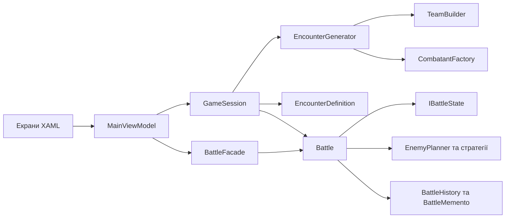

# Архітектура Iron Oath

## Межі проєктів

Arena.Core відповідає за правила та стан. Він працює без вікна. Arena.Wpf показує ці дані й передає дії через ViewModel. Arena.Core.Tests перевіряє правила через відкриті операції ядра.



## Визначення й живий стан

HeroCatalog містить п’ять союзників і сім противників. HeroDefinition та SkillDefinition описують їхні початкові можливості. Окремі екземпляри Combatant мають поточне здоров’я, щит, ефекти, відновлення навички та ознаку витраченого ходу.

TeamBuilder поступово додає героїв, призначає лідера й завершує складання через Build. Результат зберігає власну незмінну колекцію. Видалення або додавання героя до наступного варіанта команди не змінює вже зібрану команду.

CombatantFactory обчислює початкові параметри зі складністю та однією аурою. Це звичайна фабрика початкових даних. Створення сімейств фракцій та GoF Abstract Factory можна розглядати при додаванні відповідної механіки.

EncounterDefinition зберігає склад противника, лідера, складність і остаточні початкові параметри. GameSession утримує його між невдалими спробами. Кожна нова спроба отримує новий Battle. Після перемоги StartBattle підбирає нову трійку, відмінну від попередньої.

## Шлях дії

1. Гравець обирає героя, навичку та ціль.
2. ViewModel передає дію BattleFacade.
3. Поточний об’єкт стану дозволяє або відхиляє дію для цієї фази.
4. Battle перевіряє героя, готовність і ціль до зміни даних.
5. Спільні ефекти завдають шкоди, лікують або змінюють щит і статуси.
6. Перевіряється результат партії. Після останньої дії живого союзника починається фаза ворогів.
7. Результати дії потрапляють у впорядковану колекцію `Battle.Events`. Кожна подія має тип і номер раунду. Подія влучання також містить виконавця, ціль, фактичну втрату здоров’я, поглинуту щитом шкоду та стан цілі в цей момент.
8. ViewModel відтворює події обох команд і відкриває вибір наступної дії після показу наслідків. Журнал використовує той самий потік. Текстовий `Battle.Log` дає доступ до повідомлень цих подій для попередніх клієнтів.

Наприклад, «Згасання» може спершу завдати критичної шкоди, а потім накласти отруту. Для гравця це три моменти: оголошення навички, влучання й поява значка отрути. `PlayEventsAsync` передає картці збережені значення відповідної події. Навіть коли ядро вже обчислило всю дію, значок з’являється саме в момент накладання. На час відтворення `IsBusy` закриває бойові команди, а перемикач темпу лишається доступним. [Подія](../src/Arena.Core/Battles/BattleEvent.cs) · [Черга відтворення](../src/Arena.Wpf/ViewModels/MainViewModel.Playback.cs) · [Картка](../src/Arena.Wpf/ViewModels/HeroCardViewModel.cs)

Відсутня готовність навички або неправильна ціль не витрачає дію. Повторні натискання захищаються доступністю команд інтерфейсу та перевіркою HasActed у ядрі.

## Патерни та їхні учасники

| Патерн | Учасники в коді | Демонстрація |
|---|---|---|
| Builder | TeamBuilder, TeamDefinition | Спробувати зібрати трійку без носія аури, потім призначити валідного лідера |
| Facade | BattleFacade, Battle, внутрішні правила, стратегії та історія | Простий виклик UseSkill приховує перевірки й виконання бойової дії |
| State | IBattleState, PlayerTurnState, EnemyTurnState, FinishedState | Дія союзника під час ворожої фази відхиляється правилами |
| Strategy | IEnemyStrategy, DamageStrategy, SupportStrategy, ControlStrategy, EnemyPlanner | Різні ролі обирають атаку, лікування або підсилення через спільний контракт |
| Memento | Battle, BattleMemento, BattleHistory | Повернути початок раунду з тим самим здоров’ям, намірами й готовністю навичок |

RelayCommand та AsyncRelayCommand є інфраструктурою прив’язки кнопок WPF. На захисті GoF-патерни пояснюються через перелічені вище ігрові ролі.

## Контрольна точка

Після визначення намірів на початку раунду Battle створює BattleMemento. Він містить незалежні значення учасників, залишок та джерело отрути, історію подій, стан генератора критів, наміри, фазу, результат і позицію ворожої черги. BattleHistory зберігає останню контрольну точку. Відновлення повертає також InProgress після перемоги або поразки в цьому раунді. Якщо повторити ті самі дії у тому самому порядку, повторяться і критичні удари.

Знімок перевіряє належність конкретному бою. Знімки різних спроб не можна змішувати. Складність для наступного противника є налаштуванням сесії й залишається поза бойовим знімком.

## Що показати на захисті

Оглушення є статусом `Combatant`. Фази бою й далі керують порядком дій команд. На початку фази гравця `AdvancePlayerPhase` автоматично витрачає дію оглушених союзників. Ворожа черга перевіряє оглушення перед виконанням оголошеного наміру. Обидва шляхи використовують `SkipStunnedAction`. Стан учасника, захист після пропуску й кидки зберігаються у знімку, а інтерфейс показує їх за типізованими подіями. [Бій](../src/Arena.Core/Battles/Battle.cs) · [Знімок учасника](../src/Arena.Core/Battles/CombatantSnapshot.cs)

| Дія гравця | Що відбувається в коді |
|---|---|
| Обрати трьох героїв і призначити Торена лідером | `BuildTeam` збирає вибір екрана. `TeamBuilder.Build` перевіряє трійку та повертає визначення команди. `CombatantFactory.CreateSeeds` застосовує одну ауру до всієї команди. [Вибір команди](../src/Arena.Wpf/ViewModels/MainViewModel.Team.cs) · [Builder](../src/Arena.Core/Teams/TeamBuilder.cs) · [Фабрика](../src/Arena.Core/Encounters/CombatantFactory.cs) |
| Обрати «Згасання» Веспер, потім удар Дарана | `BattleFacade.UseSkill` передає запит бою. `PlayerTurnState.UseSkill` допускає дію гравця. `Battle.Execute` перевіряє готовність та ціль. `ApplyEffect` читає дані навички, записує отруту та застосовує бонус до наступного удару Дарана по отруєній цілі. [Фасад](../src/Arena.Core/Battles/BattleFacade.cs) · [Стан ходу](../src/Arena.Core/States/PlayerTurnState.cs) · [Правила бою](../src/Arena.Core/Battles/Battle.cs) |
| Простежити за останнім ворожим ходом | `ApplyEnemyStep` виконує оголошений намір. Коли черга закінчилася і бій триває, `EndRound` застосовує отруту до живих цілей у порядку слотів гравця, потім ворога. Після вибуття останнього героя сторони бій завершується негайно. В іншому разі `StartRound` обчислює нові наміри, відкриває дії та зберігає контрольну точку. [Бій](../src/Arena.Core/Battles/Battle.cs) · [Планувальник](../src/Arena.Core/Strategies/EnemyPlanner.cs) |
| Навести на ціль під щитом у різних складностях | `EnemyPlanning.AttackTarget` для одиночної атаки мінімізує здоров’я на First Blood, здоров’я разом зі щитом на Trial by Fire. На Against All Odds оцінка цілі підтримки додатково зменшується на базову атаку нападника. Рівність вирішує порядок слотів. Ціль уже оголошеного наміру зберігається. [Вибір цілі](../src/Arena.Core/Strategies/EnemyPlanning.cs) |
| Повернути раунд після критичного удару | `RestoreRound` викликає `Battle.Restore` для контрольної точки. Відновлюються здоров’я, ефекти, готовність навичок і попередні події. [Знімок](../src/Arena.Core/History/BattleMemento.cs) · [Історія](../src/Arena.Core/History/BattleHistory.cs) |
| Повторити програний бій з іншою командою | `GameSession.StartBattle` створює нових учасників зі збереженого `EncounterDefinition`. Обидві сторони починають зі свіжого стану. Після перемоги `EncounterGenerator.Generate` виключає попередню трійку. [Сесія](../src/Arena.Core/Session/GameSession.cs) · [Підбір](../src/Arena.Core/Encounters/EncounterGenerator.cs) |

Особлива навичка запам’ятовує номер наступного доступного раунду як `поточний раунд + CooldownRounds + 1`. За КД 1 використання у раунді 1 означає один повний пропуск у раунді 2 і готовність у раунді 3. Межа залежить від загального номера раунду, тому кількість дій героя не впливає на неї.

## SOLID, DRY, KISS та YAGNI


- Каталог, складання, підбір, бойова спроба та відображення мають окремі обов’язки.
- Правила ефектів і початкового масштабування спільні для обох сторін.
- Стратегії та стани замінюються через вузькі інтерфейси.
- Дванадцять профілів героїв використовують спільні механізми навичок.
- Фіксовані правила цілей та один знімок на раунд зберігають основу зрозумілою для розбору й захисту.

## Інтерфейс і перевірки

`EnemyIntentPreview` відображає вже обрану ядром навичку. Ідентифікатор цілі з наміру знаходить потрібну картку та її портрет. Ядро повторно перевіряє допустимість цілі під час виконання. `BattleResultView` відображає перемогу або поразку та керує візуальними ефектами в шарі WPF. [Наміри на екрані](../src/Arena.Wpf/ViewModels/EnemyIntentPreview.cs) · [Екран результату](../src/Arena.Wpf/Views/BattleResultView.xaml)

У Windows із .NET 8 SDK виконайте з папки `Iron Oath`.

```powershell
dotnet build ArenaTactics.sln -c Release
.\test.cmd
```

51 автоматизована перевірка охоплює підбір, бойові правила, оглушення та відновлення. Один із сценаріїв двічі відтворює кожен із 72 боїв на трьох рівнях складності й звіряє кінцевий стан та журнал. [Перелік перевірок](../tests/Arena.Core.Tests/Program.cs) · [Сценарії симуляції](../tests/Arena.Core.Tests/BattleSimulationTests.cs)
