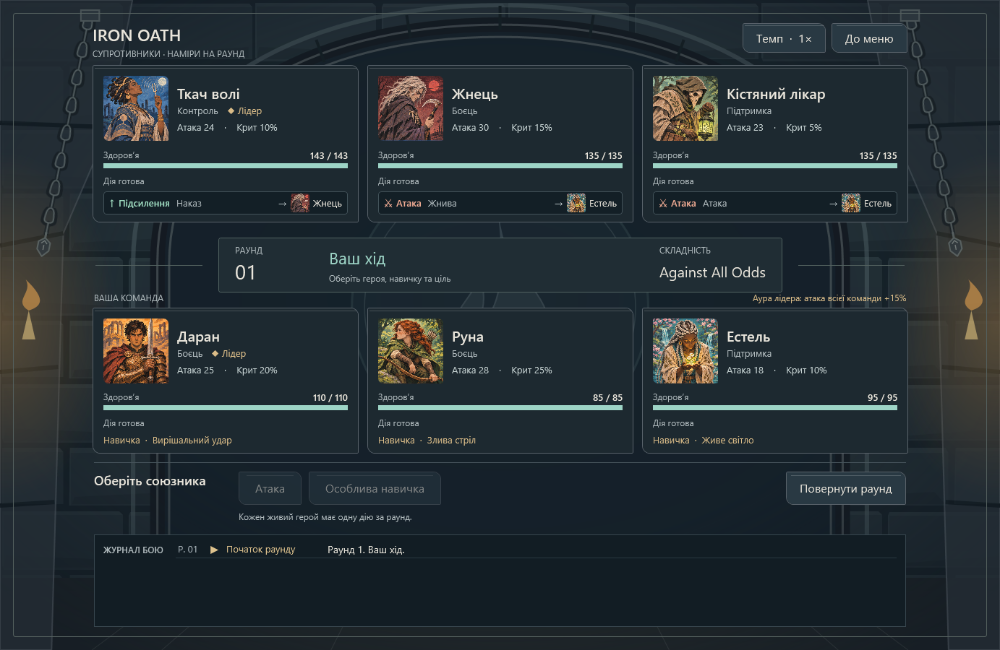

# Патерни проєктування

Навчальні проєкти з дисципліни **«Патерни проєктування»**, написані мовою C#.

## Проєкти

| Папка | Проєкт | Стан |
|---|---|---|
| [lab01-solid](lab01-solid/README.md) | Консольний каталог бібліотеки для демонстрації SOLID | Реалізовано |
| [game](game/README.md) | Iron Oath — покрокова арена 3 × 3 на WPF | Готова до гри |

## Iron Oath

Зберіть команду з трьох героїв, оберіть ауру лідера й використайте відкриті наміри ворогів проти них. Після перемоги арена підбирає нових супротивників. [Сторінка гри й запуск](game/README.md) · [Задум](game/docs/CONCEPT.md) · [Архітектура](game/docs/ARCHITECTURE.md)

[](game/README.md)

## Лабораторна робота №1 — SOLID

Каталог працює з книгами, газетами та альманахами. Підтримуються ручне додавання, створення випадкових видань фабрикою, редагування, видалення, групування та пошук за назвою, видавництвом, роком або автором.

Дані зберігаються в оперативній пам’яті. Під час запуску каталог заповнюється вигаданими прикладами з правдоподібними назвами та іменами.

### Запуск

Потрібен **.NET 8 SDK**. Із кореня репозиторію:

```powershell
cd lab01-solid
.\run.cmd
```

Або з папки `lab01-solid`:

```shell
dotnet run --project src/LibraryCatalog.Console -c Release
```

### Збірка та перевірка

Виконайте з папки `lab01-solid`:

```shell
dotnet build LibraryCatalog.sln -c Release
dotnet run --project tests/LibraryCatalog.Tests -c Release
```

Перевірки запускаються як окрема консольна програма та не потребують сторонніх NuGet-пакетів.

### Документація

- [Можливості, правила роботи та приклади команд](lab01-solid/README.md).
- [Будова програми та реалізація SOLID](lab01-solid/docs/EXPLANATION.md).
