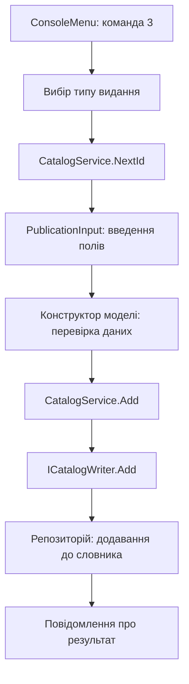

# Будова каталогу та реалізація SOLID

## Загальна схема

Програма зберігає об’єкти видань у пам’яті та виконує над ними команди користувача. Моделі описують дані, репозиторій зберігає колекцію, сервіси виконують операції й пошук, а консольні компоненти забезпечують взаємодію з користувачем.

Почніть із [Program.cs](../src/LibraryCatalog.Console/Program.cs), потім перегляньте [Publication.cs](../src/LibraryCatalog.Core/Models/Publication.cs), [Book.cs](../src/LibraryCatalog.Core/Models/Book.cs), [CatalogService.cs](../src/LibraryCatalog.Core/Catalog/CatalogService.cs) і [ConsoleMenu.cs](../src/LibraryCatalog.Console/ConsoleMenu.cs).

## Клас, об’єкт і конструктор

```csharp
var book = new Book(5, "The Lantern Keeper", "Silverleaf Press", 2001,
    "Oliver", "Mystery", 240);
```

- `Book` — клас, який описує дані книги.
- `new Book(...)` створює конкретний об’єкт і викликає конструктор.
- Аргументи конструктора передають ID, назву, видавництво, рік, автора, жанр і кількість сторінок.
- `book` — змінна з посиланням на створений об’єкт. `var` дозволяє компілятору визначити її тип як `Book`.
- `book.Title` читає властивість, а `book.GetAuthors()` викликає метод.

Властивість `public string Author { get; }` доступна лише для читання ззовні. Її значення задається конструктором після перевірки. Збережений об’єкт книги не змінюється через пряме присвоєння його властивостям.

## Моделі видань

Спільний абстрактний клас `Publication` містить ID, назву, видавництво та рік. Від нього успадковуються:

| Клас | Додаткові дані |
|---|---|
| `Book` | Автор, жанр, кількість сторінок |
| `Newspaper` | Номер, дата випуску, список колонок із журналістами |
| `Almanac` | Жанр, кількість сторінок, список творів із назвами й авторами |

`NewspaperColumn` описує колонку газети, `LiteraryWork` — твір в альманасі. Вони належать відповідним виданням і не додаються до загального каталогу окремими записами.

`Publication` не можна створити безпосередньо через `new Publication(...)`. Він задає спільні дані та договір поведінки для конкретних видань.

У конструкторі книги `base(id, title, publisher, year)` викликає конструктор `Publication`. Після заповнення спільних полів конструктор `Book` задає автора, жанр і сторінки.

`GetAuthors()` оголошено як абстрактний метод. Кожне видання перевизначає його через `override`: книга повертає автора, газета — журналістів колонок, альманах — авторів творів. Ключове слово `sealed` у конкретних класах забороняє подальше успадкування від них.

## Компоненти та їхні обов’язки

| Компонент | Відповідальність |
|---|---|
| Моделі видань | Дані та правила коректного стану об’єкта |
| `InMemoryCatalogRepository` | Колекція видань і доступ до неї |
| `CatalogService` | Додавання, редагування, видалення та видача ID |
| `CatalogSearchService` | Відбір видань за переданим критерієм |
| `RandomPublicationFactory` | Створення готових випадкових видань |
| `ConsoleInput` | Читання й перевірка введення |
| `PublicationInput` | Запит полів і створення моделей із цих даних |
| `ConsoleCatalogView` | Оформлення та виведення результатів |
| `ConsoleMenu` | Вибір дії за командою користувача |
| `Program` | Створення компонентів і передавання залежностей |

Репозиторій використовує `SortedDictionary<int, Publication>`: ключем є ID, значенням — посилання на видання. Завдяки спільному типу `Publication` одна колекція містить книги, газети й альманахи.

`GetAll()` повертає знімок колекції, закритий для зміни. Моделі незмінні після створення; вкладені списки колонок і творів копіюються та також закриваються для зміни ззовні.

## Що відбувається під час запуску

У `Program.cs` створюються репозиторій, сервіс операцій і сервіс пошуку:

```csharp
var repository = new InMemoryCatalogRepository();
var catalog = new CatalogService(repository, repository);
var search = new CatalogSearchService(repository);
```

Один об’єкт репозиторію передається сервісу каталогу двічі: як читач і як записувач. Це дві ролі того самого сховища, а не дві копії каталогу.

Далі програма додає початкові записи з `SampleCatalogData`, створює консольні компоненти та фабрику, передає їх меню й викликає `menu.Run()`.

Меню працює в циклі: показує варіанти, читає команду та через `switch` викликає відповідний метод. Команда `0` завершує цикл.

## Додавання видання

Для ручного додавання шлях викликів такий:



До завершення введення та створення коректного об’єкта колекція не змінюється. Після цього `CatalogService.Add` передає об’єкт у реалізацію запису репозиторію.

## Випадкове створення через фабрику

[RandomPublicationFactory](../src/LibraryCatalog.Core/Factories/RandomPublicationFactory.cs) реалізує `IRandomPublicationFactory`. У `Program.cs` вона отримує генератор випадкових чисел:

```csharp
var factory = new RandomPublicationFactory(new Random());
```

Меню зберігає її через інтерфейс. У пункті 4 виконуються два окремі кроки:

```csharp
Publication publication = _factory.Create(_catalog.NextId());
_catalog.Add(publication);
```

Спочатку `NextId()` визначає номер. Метод `Create(id)` вибирає тип і повертає повністю заповнений об’єкт. Об’єкт уже існує, але ще не входить до каталогу. Виклик `Add` додає до колекції посилання на цей самий об’єкт; другої копії видання не створює.

Усередині фабрики вибір типу веде до `CreateBook`, `CreateNewspaper` або `CreateAlmanac`. Ці методи викликають конструктори моделей, підбирають назви, авторів і видавництва, генерують числові поля та вкладені списки.

Це **проста фабрика — Simple Factory**. Вона зосереджує створення випадкових об’єктів в одному місці. Для четвертого виду видань її потрібно буде доповнити; точкою розширення OCP у цій лабораторній є критерії пошуку.

Ця реалізація не є GoF Factory Method: тут немає ієрархії класів-творців із перевизначенням фабричного методу. Передавання `Random` ззовні дозволяє відтворювати послідовність об’єктів у перевірках за однаковим початковим значенням генератора.

## Редагування та видалення

`ConsoleMenu.Edit()` знаходить видання за ID та передає його в `PublicationInput.Edit`. Enter залишає поточне значення поля. Після введення створюється новий коректний об’єкт того самого типу з попереднім ID.

Лише тоді `CatalogService.Update(replacement)` замінює запис у сховищі. Тому переривання введення посеред форми не залишає частково відредагованого об’єкта. Тип видання під час редагування змінювати не можна.

Видалення передає ID через `CatalogService.Remove` до репозиторію, який прибирає відповідну пару зі словника. Якщо запису немає, меню показує повідомлення.

Тип результату `Publication?` у `FindById` означає, що метод може повернути видання або `null`, якщо ID відсутній.

## Пошук

Основний алгоритм у [CatalogSearchService.cs](../src/LibraryCatalog.Core/Search/CatalogSearchService.cs):

```csharp
public IReadOnlyList<Publication> Search(ISearchCriterion criterion)
{
    ArgumentNullException.ThrowIfNull(criterion);
    return Array.AsReadOnly(_reader.GetAll().Where(criterion.Matches).ToArray());
}
```

- `_reader.GetAll()` отримує видання зі сховища.
- `criterion.Matches` перевіряє кожне видання; `Where` залишає ті, для яких результат дорівнює `true`.
- `ToArray()` формує колекцію результатів.
- `Array.AsReadOnly(...)` закриває склад результатів для зміни.

`criterion` — параметр типу інтерфейсу. Фактично в нього передається об’єкт `TitleCriterion`, `PublisherCriterion`, `YearCriterion` або `AuthorCriterion`, і викликається саме його реалізація `Matches`.

Пошук за автором використовує `publication.GetAuthors()`. Для книги, газети й альманаху цей виклик працює через спільний договір.

## S — принцип єдиної відповідальності

У компонента одна область відповідальності та пов’язана з нею причина для зміни.

- Моделі описують видання та їхній коректний стан.
- Репозиторій зберігає колекцію.
- Представлення оформлює виведення.
- Фабрика створює випадкові видання.

Зміна оформлення списку стосується `ConsoleCatalogView`; спосіб зберігання належить репозиторію. Методи `Add`, `Update`, `Remove` можуть бути в одному сервісі, оскільки це пов’язані операції. SRP не вимагає одного методу на клас.

## O — принцип відкритості та закритості

Алгоритм пошуку працює через `ISearchCriterion`. Нове правило можна додати окремим класом, зберігши реалізацію `CatalogSearchService.Search`.

Наприклад, критерій «видано не раніше зазначеного року»:

```csharp
public sealed class SinceYearCriterion : ISearchCriterion
{
    private readonly int _year;

    public SinceYearCriterion(int year)
    {
        if (year is < 1 or > 9999)
        {
            throw new ArgumentOutOfRangeException(nameof(year));
        }

        _year = year;
    }

    public bool Matches(Publication publication)
    {
        return publication.Year >= _year;
    }
}
```

Це приклад розширення, а не додатковий пункт поточного меню. Для використання такого критерію через консоль меню потрібно доповнити. Загальний алгоритм пошуку залишається незмінним. OCP не означає заборони змінювати будь-який наявний файл.

## L — принцип підстановки Лісков

`Publication` обіцяє коректні спільні поля та підтримку `GetAuthors()`. Кожен дочірній клас дотримується цього договору:

| Видання | Результат `GetAuthors()` |
|---|---|
| `Book` | Автор книги |
| `Newspaper` | Журналісти колонок |
| `Almanac` | Автори творів |

Тому загальний пошук може використовувати будь-який із цих типів через `Publication`.

Поліморфізм дає можливість викликати різні реалізації спільного методу. LSP вимагає, щоб ці реалізації зберігали очікувану поведінку. Якби газета завжди викидала `NotSupportedException` у `GetAuthors()`, виклик компілювався б, але порушував би договір і ламав пошук.

## I — принцип розділення інтерфейсів

[ICatalogReader](../src/LibraryCatalog.Core/Catalog/ICatalogReader.cs) містить `GetAll` та `FindById`, а [ICatalogWriter](../src/LibraryCatalog.Core/Catalog/ICatalogWriter.cs) — `Add`, `Update`, `Remove`.

Пошуку потрібне лише читання, тому `CatalogSearchService` отримує `ICatalogReader` і не залежить від операцій запису.

Репозиторій **реалізує** обидва інтерфейси. Сервіс пошуку їх не реалізує: він **використовує** переданий об’єкт через інтерфейс читання. Розділення прибирає непотрібні залежності споживача та не вимагає окремого інтерфейсу для кожного методу.

## D — принцип інверсії залежностей

[CatalogService](../src/LibraryCatalog.Core/Catalog/CatalogService.cs) залежить від абстракцій читання та запису:

```csharp
private readonly ICatalogReader _reader;
private readonly ICatalogWriter _writer;
```

Конкретний `InMemoryCatalogRepository` створюється в `Program.cs` і передається в конструктор сервісу. Інше сховище, яке дотримується тих самих договорів, можна підставити без зміни алгоритмів сервісу.

Так само меню отримує `IRandomPublicationFactory`, а конкретну `RandomPublicationFactory` вибирає код запуску.

DIP визначає, від яких типів залежить основна логіка. Передавання об’єкта через конструктор — використаний тут механізм упровадження залежностей. Самого створення об’єкта ззовні недостатньо, якщо сервіс усе одно вимагає конкретний клас.

`new Book(...)` для моделі даних дозволений. `readonly` забороняє замінити збережене посилання після конструктора, але не робить об’єкт репозиторію незмінним.

## Автоматичні перевірки

- `CoreTests` перевіряє моделі, спільні договори, операції каталогу та пошук.
- `FactoryTests` перевіряє заповнення випадкових видань, різноманітність і відтворюваність даних.
- `ConsoleTests` подає команди через `StringReader`, збирає виведення через `StringWriter` і перевіряє результат роботи справжнього меню.

Допоміжний клас `Check` виконує перевірки очікувань. Запускач показує `PASS` або `FAIL` та повертає ненульовий код завершення за наявності помилок. Команди запуску наведено в [README лабораторної](../README.md).
