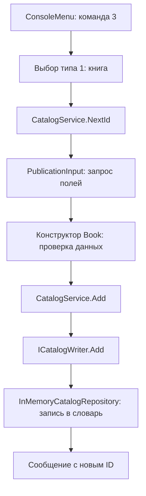

# Как работает каталог и где применяется SOLID

## С чего начать чтение

Сначала открой [Program.cs](../src/LibraryCatalog.Console/Program.cs). Это точка входа: здесь создаются хранилище, сервисы, ввод, вывод и меню. Затем посмотри [Book.cs](../src/LibraryCatalog.Core/Models/Book.cs), [Publication.cs](../src/LibraryCatalog.Core/Models/Publication.cs), [CatalogService.cs](../src/LibraryCatalog.Core/Catalog/CatalogService.cs) и [ConsoleMenu.cs](../src/LibraryCatalog.Console/ConsoleMenu.cs).

Порядок для разбора: одна книга → общая модель → коллекция каталога → одно добавление → поиск → остальные пункты меню.

## Класс, объект, свойство, метод, конструктор

```csharp
var book = new Book(5, "Учебная книга", "Издатель", 2024,
    "Автор", "Роман", 120);
```

- `Book` — класс, описание устройства книги в программе.
- `new Book(...)` — создание конкретного объекта и вызов его конструктора.
- `book` — переменная со ссылкой на этот объект.
- `book.Title` — свойство объекта, значение «Учебная книга».
- `book.GetAuthors()` — вызов метода, возвращающего авторов.
- Параметры конструктора передают исходные данные. Их порядок указан в `Book.cs`.

`var` не отменяет тип: компилятор выводит, что переменная имеет тип `Book`.

В свойстве `public string Author { get; }` есть только чтение. Внешний код не может выполнить `book.Author = "Другой"`. Конструктор один раз проверяет и присваивает автора.

## Зачем общее издание

Книга, газета и альманах имеют идентификатор, название, издательство и год. Поэтому они наследуются от `Publication`:

```csharp
public sealed class Book : Publication
```

`Publication` — абстрактный класс: самостоятельный объект `new Publication(...)` создать нельзя. Он задаёт общую часть и обязательные возможности конкретных изданий.

`base(id, title, publisher, year)` в конструкторе книги вызывает конструктор общего издания. Он заполняет общие свойства, после чего конструктор книги заполняет автора, жанр и страницы.

`abstract GetAuthors()` требует реализации в каждом виде издания. `override` означает, что конкретный вид предоставляет свою реализацию. Для книги возвращается её автор, для газеты — журналисты колонок, для альманаха — авторы включённых произведений.

`sealed` означает, что от конкретного класса наследоваться нельзя. От `Publication` можно создавать другие виды изданий.

## Данные и операции

| Область | Файлы | Почему отдельно |
|---|---|---|
| Данные | `Publication`, `Book`, `Newspaper`, `Almanac` | Описывают издания и проверяют допустимость создаваемого объекта |
| Части издания | `NewspaperColumn`, `LiteraryWork` | У колонки и произведения собственные поля |
| Хранение | `InMemoryCatalogRepository` | Знает коллекцию и способы обращения к ней |
| Операции | `CatalogService` | Координирует запись, проверяет сохранение типа, выдаёт ID |
| Поиск | `CatalogSearchService` и критерии | Отбирают издания, не меняя их |
| Создание случайных объектов | `IRandomPublicationFactory`, `RandomPublicationFactory` | Выбор типа и заполнение полей скрыты от меню |
| Ввод/вывод | Консольные классы | Общаются с пользователем, не управляют внутренней коллекцией |

Репозиторий хранит `SortedDictionary<int, Publication>`: ключ — ID, значение — объект издания. Сортированный словарь даёт стабильный порядок по ID. В одной коллекции лежат книги, газеты и альманахи, поскольку все являются `Publication`.

`GetAll()` отдаёт снимок списка. Код снаружи не получает изменяемый словарь. Объекты внутри снимка неизменяемы.

У вложенных списков тоже создаётся копия, закрытая для изменения: изменение исходного списка не меняет уже созданную газету или альманах.

## Что происходит при добавлении книги



1. `ConsoleMenu` распознаёт пункт и вызывает `AddChosen()`.
2. `CatalogService.NextId()` выдаёт следующий номер, учитывая уже выданные и существующие номера.
3. `PublicationInput` вызывает методы `ConsoleInput` для каждого поля.
4. Конструктор `Book` создаёт проверенный объект. До этого момента каталог не изменён.
5. `CatalogService.Add(book)` передаёт книгу в `_writer.Add(book)`.
6. `_writer` имеет тип интерфейса, но фактический объект — созданный в `Program` репозиторий. Поэтому выполняется его реализация `Add`.

Один объект репозитория передан сервису дважды: в роли читателя и в роли писателя. Это два доступных договора одного объекта, а не две копии каталога.

## Что делает фабрика в пункте 4

В [Program.cs](../src/LibraryCatalog.Console/Program.cs) создаётся фабрика:

```csharp
var factory = new RandomPublicationFactory(new Random());
```

Она передаётся в `ConsoleMenu`, где хранится как интерфейс `IRandomPublicationFactory`. При команде `4 - Generate a random publication` выполняется:

```csharp
Publication publication = _factory.Create(_catalog.NextId());
_catalog.Add(publication);
```

`NextId()` назначает номер, `Create(id)` создаёт готовый объект, `Add` сохраняет его. Пользователь не вводит ни одно поле. Меню знает только договор «получи ID и верни издание».

В [RandomPublicationFactory.cs](../src/LibraryCatalog.Core/Factories/RandomPublicationFactory.cs) метод `Create` случайно выбирает один из трёх типов и вызывает приватный `CreateBook`, `CreateNewspaper` или `CreateAlmanac`. Внутри этих методов остаются обычные `new Book(...)` и аналогичные конструкторы: фабрика не отменяет создание объектов, она собирает эту работу в одном месте.

Поля заполняются из наборов названий, авторов и издательств; числа и дата выбираются в допустимых диапазонах. Вложенные колонки/произведения также создаются фабрикой. Начальные четыре примера остаются в `SampleCatalogData`; случайное создание из этого класса вынесено.

Это **Simple Factory — простая фабрика**, не GoF Factory Method с переопределением фабричного метода в подклассах создателя. Такой вариант выбран, чтобы механизм оставался небольшим и объяснимым. При появлении четвёртого типа фабрику потребуется дополнить; заявленная точка OCP в этой лабораторной по-прежнему — критерии поиска.

Связь с SOLID: **S** отделяет создание случайных данных от меню, **D** позволяет меню зависеть от интерфейса фабрики. `Random` передаётся снаружи: в тестах одинаковое начальное значение генератора воспроизводит одинаковые объекты.

## Что происходит при редактировании

`ConsoleMenu.Edit()` находит запись по ID и передаёт её форме ввода. Форма показывает текущие поля; Enter оставляет прежнее значение. Затем она создаёт новый объект того же типа с прежним ID.

Только после успешного ввода и проверки `CatalogService.Update(replacement)` заменяет объект в хранилище. Поэтому неверный ввод или конец потока посреди формы не меняет прежнюю запись. Создаётся замена, а не последовательно меняются поля сохранённого объекта.

Отсутствующий ID возвращает `null`; меню выводит сообщение. `Publication?` в типе результата прямо означает, что запись может отсутствовать.

## Что происходит при поиске

```csharp
public IReadOnlyList<Publication> Search(ISearchCriterion criterion)
{
    return Array.AsReadOnly(_reader.GetAll().Where(criterion.Matches).ToArray());
}
```

Это основа метода в [CatalogSearchService.cs](../src/LibraryCatalog.Core/Search/CatalogSearchService.cs); перед ней проверяется, что критерий не `null`.

- `_reader.GetAll()` получает издания.
- `Where(criterion.Matches)` оставляет те, для которых критерий вернул `true`.
- `ToArray()` формирует результат.
- `Array.AsReadOnly(...)` не позволяет менять состав результата через возвращённую коллекцию.

Например, `AuthorCriterion` вызывает `GetAuthors()` у каждого издания и проверяет вхождение текста. Ему не нужны условия «это книга» или «это газета»: каждый тип сам предоставляет своих авторов.

## S — Single Responsibility

Одна область ответственности, а не один метод на класс.

- `Book` описывает данные книги и проверяет её допустимое состояние при создании.
- `ConsoleInput` читает и проверяет ввод, но не сохраняет издания.
- `ConsoleCatalogView` оформляет вывод, но не выполняет поиск.
- `InMemoryCatalogRepository` хранит записи, но не спрашивает пользователя о данных.

Если меняется оформление списка, исправляем `ConsoleCatalogView`. Если меняется способ хранения, работаем с реализацией хранилища. Если бы всё находилось в `Program`, эти причины изменения были бы смешаны.

Наличие методов `Add`, `Update`, `Remove` у одного сервиса допустимо: это связанные операции каталога.

## O — Open/Closed

Общий поиск зависит от `ISearchCriterion`, а не от четырёх конкретных условий. Новый критерий можно добавить отдельным классом:

```csharp
public sealed class SinceYearCriterion : ISearchCriterion
{
    private readonly int _year;

    public SinceYearCriterion(int year)
    {
        if (year is < 1 or > 9999)
        {
            throw new ArgumentOutOfRangeException(nameof(year));
        }

        _year = year;
    }

    public bool Matches(Publication publication)
    {
        return publication.Year >= _year;
    }
}
```

После подключения этого критерия поиск умеет искать издания не раньше указанного года. **Метод `CatalogSearchService.Search` не меняется.** Такой пример проверяется отдельным тестовым критерием.

Для нового пункта интерфейса меню надо дополнить. Принцип не обещает, что при любой новой функции не изменится ни один существующий файл. Точка расширения здесь — условия общего поиска. Консольные формы для трёх известных типов используют обычный `switch`; это отдельный выбор интерфейса, а не демонстрация OCP.

## L — Liskov Substitution

Общий код рассчитывает, что `Publication` имеет корректные название, год, издательство и поддерживает получение авторов. Книга, газета и альманах соблюдают этот договор.

```csharp
foreach (Publication publication in catalog.GetAll())
{
    Console.WriteLine(publication.Title);
    Console.WriteLine(string.Join(", ", publication.GetAuthors()));
}
```

Здесь разные конкретные объекты работают через общий тип. От газеты не требуется вымышленный единственный автор: она возвращает журналистов своих колонок. Ни один тип не отвечает на общую операцию «это не поддерживается».

Плохая реализация `GetAuthors()`, которая всегда бросает `NotSupportedException`, компилировалась бы, но ломала общий поиск. LSP касается сохранения поведения, а не только правильного синтаксиса наследования.

## I — Interface Segregation

[ICatalogReader](../src/LibraryCatalog.Core/Catalog/ICatalogReader.cs) содержит чтение, [ICatalogWriter](../src/LibraryCatalog.Core/Catalog/ICatalogWriter.cs) — запись.

`CatalogSearchService` получает только `ICatalogReader`. Его код не зависит от методов удаления и изменения. При этом реальный репозиторий реализует оба интерфейса: такое разделение не запрещает одному классу иметь обе возможности.

Не требуется по интерфейсу на каждый метод. Интерфейс объединяет связанные возможности, нужные конкретному потребителю.

## D — Dependency Inversion

В [CatalogService.cs](../src/LibraryCatalog.Core/Catalog/CatalogService.cs):

```csharp
private readonly ICatalogReader _reader;
private readonly ICatalogWriter _writer;

public CatalogService(ICatalogReader reader, ICatalogWriter writer)
{
    // В реальном коде здесь также проверяется отсутствие null.
    _reader = reader;
    _writer = writer;
}
```

В `Program.cs`:

```csharp
var repository = new InMemoryCatalogRepository();
var catalog = new CatalogService(repository, repository);
```

Основная логика зависит от интерфейсов. Конкретную реализацию выбирает место запуска. Замена хранилища не требует изменения алгоритма сервиса, если новое хранилище соблюдает те же договоры.

Передача объекта через конструктор называется внедрением зависимостей. DIP — сам принцип направления зависимостей. Это связанные, но разные понятия. `readonly` запрещает заменить сохранённую ссылку после конструктора; это не делает сам объект репозитория неизменяемым.

`new Book(...)` не нарушает DIP: обычные модели данных можно создавать. Избегаем создания конкретного репозитория внутри зависимого от него сервиса.

## Проверки и их назначение

`CoreTests` проверяет правила и результаты операций. `ConsoleTests` подаёт подготовленные строки в меню и проверяет итоговый каталог и сообщения. Вместо реальной клавиатуры используется `StringReader`, вместо экрана — `StringWriter`; логика меню остаётся настоящей.

`Check` содержит простые утверждения. Если ожидание не выполнено, бросается исключение; запускатель отмечает `FAIL` и возвращает ненулевой код выхода. Это небольшой автономный набор проверок, не отдельный продуктовый компонент.

Тесты не доказывают, что пользователь уже освоил код. Для этого нужно пройти сценарии и объяснить их самостоятельно.
